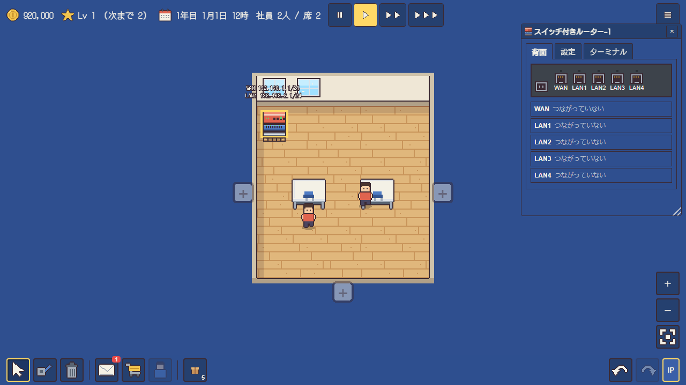

# わたしのネットワーク屋 (My Network Guy)
ネットワーク構築を学べる経営シミュレーションゲームです。<br />
Web ブラウザで動作し、バックエンドは不要です。

初回は5x5の狭い自社のオフィスで社員2人とデスク2つがあります！ 社員の給与を払うために、案件を受注し、他社のオフィスにてネットワークを構築するなどして稼ぎます！

自社のオフィスにもサーバやルータ、スイッチなど設置でき、今後そういったリリースを顧客に売り込むといったしくみもつくっていく予定です！

## ゲーム内容
小さなネットワーク工事の会社を経営し、依頼を受けて社内LANを設計・構築するドット絵の経営シミュレーションゲームです。機器を置き、ケーブルでつなぎ、IP アドレスやルーティングを設定して通信を通すことで、ネットワークの基礎を遊びながら学習できます。題材は実際の LAN の仕組みに沿っており、ゲームの中で扱う用語や設定の書き方は、資格試験などで使われるものにそろえています。



### 会社の経営
最初は 5×5 マスの小さな自社オフィスで、資金 1,000,000円、社員2人、机2つから始めます。ゲーム内の時間は実時間の1秒が1時間で進み、一時停止や早送りもできます。社員には月ごとに給与を支払う必要があり、資金が尽きると会社を続けられなくなります。そのため、依頼を受注して報酬を得ながら、少しずつ会社を大きくしていきます。

依頼は数日ごとにメールで届きます。依頼には予算と期日があり、受注すると依頼先のオフィスの地図に移って作業を始めます。会社の規模が大きくなるにつれて、PC 2台を直結するだけの依頼から、部署ごとにネットワークを分ける依頼、社内の Web サーバーを公開する依頼、本社と支社をつなぐ依頼、ファイアウォールで外部からの通信を止める依頼へと、扱う内容が広がっていきます。PC の台数や部屋の配置が毎回変わる定型の依頼もあり、同じ種類でも組み方を考え直す必要があります。自社のオフィスを整える自社案件もあり、報酬として機器を受け取れます。

### ネットワークの設計と施工
依頼先の地図には、事務用PC、ノートPC、L2スイッチ、ルーター、スイッチ付きルーター、L3スイッチ、サーバー、GPUサーバー、ファイアウォールなどを置けます。機器は倉庫から取り出して配置し、ポートとポートをケーブルでつなぎます。ケーブルには LAN ケーブルと光ファイバーがあり、通れる長さと価格が異なります。部屋をまたぐ長い配線では、途中にスイッチを置いて中継するか、光ファイバーを使うかを選びます。

機器を押すと機器の画面が開き、背面のポートの接続状態の確認、IP アドレスやゲートウェイ、ルーターの経路の設定、サーバーのサービスの起動と停止などを行えます。同じ設定は、Cisco IOS に準拠したターミナルからも入力できます。`ping` や `traceroute` で通信の経路を確かめ、`show ip route` や `show running-config` で設定を見直しながら、通信が通らない原因を探します。

依頼には「所長のPCから事務員のPCへ Ping が通る」「すべての PC から社内サーバーの Web ページを見られる」「外部からの通信がファイアウォールで止められている」といった達成条件があります。テストですべての条件を満たすと、社員に施工を依頼できます。社員は勤務時間の中で現場に向かい、機器を設置して配線します。施工が終わると検収が行われ、納品の結果が出ます。

### 評価と成長
納品の結果は、費用が予算に収まったか、検収のやり直しがなかったか、期日に間に合ったかによって★1〜★3で評価されます。評価が高いほど報酬が増え、期日に遅れると報酬が減ります。安い機器で過不足なく組み、一度で検収に通すことが高い評価につながります。獲得した★は会社の評判として積み上がり、これまでの仕事の出来を表します。

会社の成長は、★とは別に経験値と会社のレベルで表します。経験値は依頼の納品を中心に、初めて扱う機器や依頼への挑戦、社員の採用や研修、オフィスの拡張など、さまざまな行動で増えます。レベルが上がると、新しい機器や家具、依頼の種類、社員の職種、夜勤の雇用、オフィスの拡張などが順に解放され、お金や機器の報酬も受け取れます。

### 社員とオフィス
社員にはネットワーク、インフラ、セキュリティの職種とレベルがあり、施工の速さは職種が依頼に合っているか、レベル、席に座れているかで変わります。社員は施工で経験を積んで成長し、研修でまとめて経験値を得たり、資格を取得したりできます。会社のレベルが上がると、日勤だけでなく夜勤の社員も雇えるようになり、夜の間も施工を進められます。社員は休憩を取りながら働き、オフィスの中を歩き回ったり、口癖をつぶやいたりします。

報酬で機器や家具を購入すると、倉庫に入ります。家具はオフィスに置いて使い、観葉植物やコーヒーメーカーは社員の施工の速さを、本棚は経験値の得やすさを高めます。机が増えれば座れる社員も増えます。オフィスは拡張で広げられ、別室を設けることもできます。自社オフィスにもサーバーやルーター、スイッチなどを置けます。今後は、それらを顧客に売り込む仕組みも追加する予定です。

### サンドボックス
お金や依頼の制約なしに、自由にネットワークを組めるモードです。部屋の大きさを決めて、試したい構成をその場で組み、テストで通信を確かめられます。

### 遊べる環境
パソコンとスマホのブラウザで遊べます。進行はブラウザの中に保存されます。ホーム画面に追加するとアプリのように起動でき、一度開いたあとはオフラインでも遊べます。

### 遊び方と操作
案件の流れ、キー操作、機器の画面の説明は [docs/guide.md](docs/guide.md) にあります。

## 開発
前提環境: Node.js（npm を含む）

```bash
npm install       # 依存パッケージのインストール
npm run dev       # 開発サーバーの起動
npm run build     # ビルド（型チェックを含む）
npm run preview   # ビルド結果の確認
npm test          # テストの実行（vitest）
```

## 技術スタック
- TypeScript / Vite
- Pixi.js（オフィスのマップ、ドット絵、配線の描画）
- React（HUD、機器の画面、ショップなどの UI）
- Zustand（状態管理）
- Dexie（ブラウザ内のセーブデータ）
- zod（ゲームデータの検証）

## ドキュメント
文書は [docs/](docs/) にあります。
