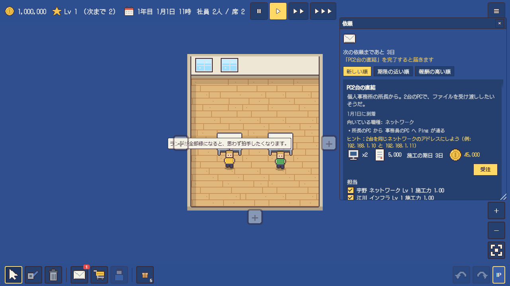

# 依頼一覧
依頼（案件）の内容をまとめます。
遊び方と受注の操作は [遊び方と操作](guide.md)、解禁・評価・報酬の仕組みは [ゲームの仕組み](game-system.md) を見てください。

## 備考
「前提」は、その依頼を受けるために達成しておく依頼です。「解禁」は、その依頼が届く会社のレベルです。前提を達成し、会社のレベルが解禁に達すると届きます。「予算」は、施工にかける費用の目安です。費用が予算を超えると、★が下がります。「期日」は、受注した日からの日数です。期日を過ぎると、報酬が 1日ごとに 10% 減り、50% までで止まります。「達成条件」は、納品の検収で確かめられる条件です。報酬のほかに、★の数だけ評判が上がります。

## 主線の依頼

### PC2台の直結
依頼元の話は、個人事務所の所長からのものです。2台のPCで、ファイルを受け渡ししたいそうです。ヒントは、2台を同じネットワークのアドレスにすることです（例: 192.168.1.10 と 192.168.1.11）。前提はなし、解禁は Lv1 です。向いている職種はネットワークです。場所は小さな事務所で、最初から所長のPCと事務員のPCが置かれています。どちらも固定されています。達成条件は、所長のPCから事務員のPCへ Ping が通ることです。予算は 5,000円、期日は 3日です。報酬は 45,000円です。

### 小規模事務所LAN
依頼元の話は、3名の事務所からのものです。全員のPCを、互いにつないでおきたいという話です。ヒントは、スイッチでまとめることです。前提は「PC2台の直結」、解禁は Lv2 です。向いている職種はネットワークです。場所は小さな事務所で、最初から受付のPC、経理のPC、総務のPCが置かれています。どれも固定されています。達成条件は、3台のPCが相互に Ping で通信できることです。予算は 25,000円、期日は 5日です。報酬は 90,000円です。

### 部署間接続
依頼元の話は、営業部と開発部からのものです。ネットワークを分けたまま、互いに通信できれば足りるということです。各PCの設定には触れない決まりです。ヒントは、ルーターの口のアドレスを、PCのネットワークに合わせることです。前提は「小規模事務所LAN」、解禁は Lv4 です。向いている職種はネットワークです。場所は2部屋のオフィスで、最初から営業部のPC 2台（192.168.1.x）と開発部のPC 2台（192.168.2.x）が置かれています。設定は固定されています。達成条件は、4台のPCが相互に Ping で通信できることです。予算は 139,000円、期日は 7日です。報酬は 300,000円です。

### 社内Webサーバーの接続
依頼元の話は、社内向けのWebサーバーを入れたので、社員のPCから見られるようにしてほしいというものです。ヒントは、サーバーのネットワークも、ルーターにつなぐことです。前提は「部署間接続」、解禁は Lv6 です。向いている職種はインフラです。場所は2部屋のオフィスで、最初から社内Webサーバーと社員のPC 2台が置かれています。設定は固定されています。達成条件は、社員のPC 両方から、社内Webサーバーの Web ページを見られることです。予算は 117,000円、期日は 10日です。報酬は 330,000円です。

### 2拠点接続
依頼元の話は、本社と支社の間で、拠点をまたぐ通信が必要になったというものです。ヒントは、ルーター同士を結び、相手拠点への経路を登録することです。前提は「社内Webサーバーの接続」、解禁は Lv18 です。向いている職種はネットワークです。場所は本社と支社の2拠点で、最初から本社のPC 2台と支社のPC 2台が置かれています。設定は固定されています。達成条件は、4台のPCが相互に Ping で通信できることです。予算は 254,000円、期日は 14日です。報酬は 600,000円です。

### 事務所の外部接続
依頼元の話は、事務所のPCから、ISP を通してインターネットへ出したいというものです。回線との間には、必ずファイアウォールを置く決まりです。ヒントは、ファイアウォールを回線終端につなぎ、内側と外側の口にアドレスと NAPT を設定することです。規則は、変換の前の社内のアドレスで書きます。前提は「2拠点接続」、解禁は Lv27 です。向いている職種はセキュリティです。場所は2部屋のオフィスで、最初から社員のPC 2台と回線終端が置かれています。達成条件は 2つあります。1つ目は、ファイアウォールを1台以上置くことです。2つ目は、すべてのPCが回線の先（インターネット）へつながることです。予算は 200,000円、期日は 12日です。報酬は 520,000円です。

## 応用の依頼
主線の依頼を達成すると届く依頼です。

### 営業と経理を分ける
依頼元の話は、営業と経理のPCが同じスイッチにつながっているが、経理のPCは営業から見えないようにしたいというものです。スイッチを1台置き、VLAN で部署を分けます。ヒントは、4台のPCをスイッチにつなぎ、口ごとに access の VLAN を設定し、営業と経理で別の VLAN にすることです。前提は「部署間接続」、解禁は Lv12 です。向いている職種はネットワークです。場所は小さな事務所で、最初から営業のPC 2台と経理のPC 2台が置かれています。達成条件は、営業のPC同士、経理のPC同士がそれぞれ Ping で通信でき、営業と経理が互いに通信できないことです。予算は 60,000円、期日は 8日です。報酬は 150,000円です。

### 部署の間をつなぎ、来客用を切り離す
依頼元の話は、部署が4つになり、部署の間の通信が必要になったというものです。来客用の席だけは、社内から切り離します。ルーターを2台置くより、L3スイッチ1台で済ませたい依頼です。ヒントは、L3スイッチの口を部署ごとの VLAN に分け、VLAN ごとに SVI を作ることです。来客用は別の VLAN にして、SVI を作りません。前提は「営業と経理を分ける」、解禁は Lv20 です。向いている職種はネットワークです。場所は2部屋のオフィスで、最初から部署A〜DのPCと来客用のPCが置かれています。達成条件は、部署A〜Dの4台が相互に Ping で通信でき、来客用のPCが4台と互いに通信できないことです。予算は 300,000円、期日は 14日です。報酬は 780,000円です。

### 社員 20 台のアドレスを自動で配る
依頼元の話は、社員 20台のPCのアドレスを、1台ずつ手で入れるのをやめたいというものです。DHCP サーバーを置き、部屋ごとにネットワークを分けたうえで、アドレスを自動で配ります。ヒントは、サーバーにプールを作り、ルーターの口に ip helper-address でサーバーを指定することです。別のネットワークのPCも、アドレスを受け取れます。前提は「部署間接続」、解禁は Lv23 です。向いている職種はネットワークです。場所は2部屋のオフィスで、最初から社員のPC 20台と DHCP サーバーが置かれています。PCは自動（DHCP）の設定です。達成条件は、20台のPCが自動でアドレスを受け取り、20台とサーバーが相互に Ping で通信できることです。予算は 300,000円、期日は 12日です。報酬は 650,000円です。

### 事務所をインターネットへつなぐ
依頼元の話は、社員のPCからインターネットを見たいというものです。社内は 192.168.1.0/24 のプライベートアドレスで、そのままでは外へ出られません。ルーターで社内のアドレスを回線のアドレスに変えて、外へ出します。ヒントは、ルーターの回線側の口に ISP と同じネットワークのアドレスを付け、ip nat outside と ip nat inside、ip nat napt を設定することです。既定の経路（ISP のアドレス）も必要です。前提は「2拠点接続」、解禁は Lv10 です。向いている職種はネットワークです。場所は2部屋のオフィスで、最初から社員のPC 2台と回線終端が置かれています。達成条件は、すべてのPCが回線の先へつながることです。予算は 150,000円、期日は 10日です。報酬は 380,000円です。

### 2社の ISP で回線を冗長にする
依頼元の話は、回線が1本だと、ISP の障害で全員が外部へ出られなくなるというものです。ISP-A と ISP-B の2社に接続し、片方が止まっても、社員のPCが外部へ届くようにします。ヒントは、境界ルーターを2つの回線終端につなぎ、PC側にスイッチを置くことです。各 ISP の AS 番号と neighbor を設定すると、BGP の隣接が2本になります。前提は「事務所の外部接続」、解禁は Lv30 です。向いている職種はネットワークです。場所は2部屋のオフィスで、最初から社員のPC 2台、境界ルーター、ISP-A と ISP-B の回線終端が置かれています。達成条件は 2つあります。1つ目は、境界ルーターの BGP の隣接が2本以上確立していることです。2つ目は、回線を1本止めても、すべてのPCが外部へつながることです。予算は 300,000円、期日は 15日です。報酬は 900,000円です。

## 修理の依頼
すでに引かれたネットワークの不具合を直す依頼です。依頼文には症状だけが書かれています。報酬と解禁は、前の依頼を達成した順に進みます。

| 依頼 | 依頼文 | 前提 | 解禁 | 職種 | 予算 | 期日 | 報酬 |
| --- | --- | --- | --- | --- | --- | --- | --- |
| 新しいPCを入れたら受付のPCが不安定 | 新しく入れたPCをつないでから、受付のPCがときどきつながらなくなった。原因を調べて直してほしい。 | 「小規模事務所LAN」 | Lv5 | ネットワーク | 20,000円 | 5日 | 120,000円 |
| 開発部のPCが営業部とつながらない | 営業部と開発部をルーターでつないだが、部署の間で通信できない。同じ部署の中は問題なくつながる。原因を調べて直してほしい。 | 「新しいPCを入れたら受付のPCが不安定」 | Lv7 | ネットワーク | 30,000円 | 5日 | 280,000円 |
| スイッチを増やしたら全員つながらない | スイッチを1台増やしたところ、全部のPCがつながらなくなった。原因を調べて直してほしい。 | 「開発部のPCが営業部とつながらない」 | Lv9 | ネットワーク | 20,000円 | 5日 | 200,000円 |
| 増やしたPCだけほかとつながらない | PCを増やしたところ、新しいPCだけほかのPCとつながらない。原因を調べて直してほしい。 | 「スイッチを増やしたら全員つながらない」 | Lv11 | ネットワーク | 20,000円 | 5日 | 260,000円 |
| 3階の経理のPCだけ2階とつながらない | 2階と3階の経理のPCの間だけ、通信できない。営業のPC同士は階をまたいでもつながる。原因を調べて直してほしい。 | 「増やしたPCだけほかとつながらない」 | Lv16 | ネットワーク | 30,000円 | 5日 | 300,000円 |
| 新しい拠点のネットワークだけ届かない | 新しい拠点のルーターを増やしたが、本社のPCから新しい拠点のPCへ通信できない。ほかの拠点の間は問題なくつながる。原因を調べて直してほしい。 | 「3階の経理のPCだけ2階とつながらない」 | Lv58 | ネットワーク | 30,000円 | 5日 | 600,000円 |
| 増設した拠点のネットワークが届かない | 拠点を増やして新しい区画のネットワークを作ったが、本社のPCから増設した拠点のPCへ通信できない。原因を調べて直してほしい。 | 「新しい拠点のネットワークだけ届かない」 | Lv58 | ネットワーク | 30,000円 | 5日 | 640,000円 |
| 受付に置いたPCだけ、無線でつながらない | 受付に新しく置いたPCだけ、無線のアクセスポイントにつながらない。社員のノートPCはつながっている。原因を調べて直してほしい。 | 「増設した拠点のネットワークが届かない」 | Lv60 | ネットワーク | 30,000円 | 5日 | 600,000円 |
| 回線を1本止めると、外から見えなくなる | 回線を2本に増やしたところ、片方の回線を止めると、社内のPCが外から見えなくなる。両方がつながっているときは問題ない。原因を調べて直してほしい。 | 「受付に置いたPCだけ、無線でつながらない」 | Lv60 | ネットワーク | 30,000円 | 5日 | 600,000円 |
| 増やした部屋のPCだけ、本社と通信できない | 新しい部屋に置いたPCだけ、本社のPCと通信できない。部屋のPC同士は通信できる。原因を調べて直してほしい。 | 「回線を1本止めると、外から見えなくなる」 | Lv60 | ネットワーク | 30,000円 | 5日 | 600,000円 |
| ルーターを1台止めると、社内のPCがサーバーへ届かなくなる | ルーターを2台にしたが、片方のルーターを止めたところ、社内のPCから社内サーバーへ届かなくなった。両方が動いているときは問題ない。原因を調べて直してほしい。 | 「増やした部屋のPCだけ、本社と通信できない」 | Lv60 | ネットワーク | 30,000円 | 5日 | 600,000円 |

## 社内の依頼
自社の事務所を整える依頼です。期日はありません。報酬は、お金のほかに機器が届くものがあります。納品すると、施工の進みが速くなります。

### 自社LANの構築
依頼元の話は、自分たちの事務所にもネットワークを作るというものです。ヒントは、PCを買って机に置くことです。前提は「PC2台の直結」、解禁は Lv2 です。向いている職種はインフラです。場所は自社の事務所です。達成条件は、PCを2台以上置き、すべてのPCが相互に Ping で通信できることです。予算は 250,000円です。報酬は 30,000円と L2スイッチ（8ポート）1台で、施工の進みが 20% 速くなります。

### 自社サーバーの導入
依頼元の話は、社内の資料を、サーバーにまとめて置くというものです。ヒントは、サーバーを買ってつなぐことです。前提は「部署間接続」と「自社LANの構築」、解禁は Lv6 です。向いている職種はインフラです。場所は自社の事務所です。達成条件は、サーバーを1台以上置き、すべてのPCからサーバーの Web ページを見られることです。予算は 431,000円です。報酬はサーバー1台で、施工の進みが 30% 速くなります。

### 社内のファイアウォール
依頼元の話は、社内のサーバーを外に出すため、ファイアウォールを置くというものです。ヒントは、規則で、社内からサーバーのWebだけを許可することです。前提は「自社サーバーの導入」、解禁は Lv27 です。向いている職種はセキュリティです。場所は自社の事務所です。達成条件は、ファイアウォールを1台以上置き、すべてのPCからサーバーの Web ページを見られることです。予算は 380,000円です。報酬はファイアウォール1台で、施工の進みが 10% 速くなります。

## 定型の依頼
定型の依頼は、条件を満たすと何度も届きます。PCの台数や距離で、予算と報酬が変わります。依頼文は、依頼ごとに決まっています。

| 依頼 | 解禁 | 前提 | 職種 | 達成条件 | 予算（基本・PC1台ごと・マスごと） | 期日 | 報酬（基本・PC1台ごと） |
| --- | --- | --- | --- | --- | --- | --- | --- |
| 小規模LANの構築 | Lv1 | 「小規模事務所LAN」 | インフラ | すべてのPCが相互に Ping で通信できる | 300円・4,300円・500円 | 7日 | 45,000円・12,000円 |
| カフェの客席 | Lv2 | 「小規模事務所LAN」 | インフラ | すべてのPCが相互に Ping で通信できる | 8,150円・4,750円・500円 | 7日 | 50,000円・12,000円 |
| 事務所のプリンターの共有 | Lv3 | 「小規模事務所LAN」 | インフラ | プリンターを1台以上置く。すべてのPCからプリンターに届く。すべてのPCが相互に Ping で通信できる | 44,000円・3,750円・500円 | 7日 | 50,000円・10,000円 |
| 診療所の受付と診察室 | Lv4 | 「小規模事務所LAN」 | インフラ | すべてのPCが相互に Ping で通信できる | 42,000円・0円・500円 | 8日 | 60,000円・13,000円 |
| カフェのお客さん用ネットワーク | Lv5 | 「小規模事務所LAN」 | インフラ | 指定したグループのPCが相互に Ping で通信できる。指定した2つのグループが、互いに通信できない | 4,600円・3,750円・500円 | 8日 | 70,000円・13,000円 |
| 図書館の検索端末とプリンター | Lv5 | 「小規模事務所LAN」 | インフラ | プリンターを1台以上置く。すべてのPCからプリンターに届く。すべてのPCが相互に Ping で通信できる | 60,000円・750円・500円 | 9日 | 60,000円・11,000円 |
| 2部屋のLAN | Lv6 | 「部署間接続」 | インフラ | すべてのPCが相互に Ping で通信できる | 1,750円・3,250円・500円 | 10日 | 60,000円・15,000円 |
| 会計事務所の社内掲示板 | Lv7 | 「小規模事務所LAN」 | インフラ | サーバーを1台以上置く。すべてのPCから、サーバーのWebページを見られる | 419,000円・3,250円・500円 | 8日 | 70,000円・12,000円 |
| 診療所のカルテのサーバー | Lv8 | 「社内Webサーバーの接続」 | インフラ | サーバーを1台以上置く。指定したPCから、サーバーのWebページを見られる。指定したグループのPCが相互に Ping で通信できる。指定した2つのグループが、互いに通信できない | 446,000円・0円・500円 | 10日 | 110,000円・14,000円 |
| コワーキングスペース | Lv8 | 「小規模事務所LAN」 | インフラ | すべてのPCが相互に Ping で通信できる | 900円・4,250円・500円 | 9日 | 70,000円・12,000円 |
| 図書館の蔵書検索 | Lv9 | 「社内Webサーバーの接続」 | インフラ | サーバーを1台以上置く。プリンターを1台以上置く。すべてのPCから、サーバーのWebページを見られる。すべてのPCからプリンターに届く | 479,000円・750円・500円 | 10日 | 110,000円・12,000円 |
| 飲食店の注文端末 | Lv9 | 「小規模事務所LAN」 | インフラ | スイッチ付きルーターを1台以上置く。すべてのPCが相互に Ping で通信できる | 110,000円・1,000円・500円 | 6日 | 70,000円・12,000円 |
| ホテルの客室 | Lv10 | 「部署間接続」 | インフラ | すべてのPCが相互に Ping で通信できる | 52,000円・0円・500円 | 10日 | 80,000円・14,000円 |
| 中学校のパソコン室 | Lv11 | 「小規模事務所LAN」 | インフラ | すべてのPCが相互に Ping で通信できる | 12,900円・2,600円・550円 | 12日 | 80,000円・8,000円 |
| 物流倉庫の端末 | Lv12 | 「小規模事務所LAN」 | インフラ | すべてのPCが相互に Ping で通信できる | 50円・3,500円・700円 | 11日 | 90,000円・11,000円 |
| 営業と経理のネットワーク | Lv13 | 「部署間接続」 | ネットワーク | ルーターを1台以上置く。すべてのPCが相互に Ping で通信できる | 88,000円・3,000円・500円 | 10日 | 90,000円・15,000円 |
| 離れた倉庫と事務所 | Lv15 | 「小規模事務所LAN」 | ネットワーク | すべてのPCが相互に Ping で通信できる | 67,000円・0円・500円 | 10日 | 90,000円・15,000円 |
| 病棟のナースステーション（サーバーあり） | Lv16 | 「社内Webサーバーの接続」 | インフラ | サーバーを1台以上置く。指定したPCから、サーバーのWebページを見られる。指定したグループのPCが相互に Ping で通信できる。指定した2つのグループが、互いに通信できない | 568,000円・0円・500円 | 12日 | 160,000円・15,000円 |
| 設計事務所の社内サーバー | Lv17 | 「部署間接続」 | ネットワーク | ルーターを1台以上置く。サーバーを1台以上置く。すべてのPCから、サーバーのWebページを見られる | 502,000円・3,250円・500円 | 12日 | 120,000円・15,000円 |
| 2拠点のPC接続 | Lv18 | 「2拠点接続」 | ネットワーク | すべてのPCが相互に Ping で通信できる | 0円・3,650円・500円 | 12日 | 100,000円・25,000円 |
| 銀行の支店 | Lv19 | 「部署間接続」 | インフラ | ルーターを1台以上置く。サーバーを1台以上置く。すべてのPCから、サーバーのWebページを見られる | 500,000円・3,250円・500円 | 12日 | 130,000円・15,000円 |
| 部署をまたぐ通信 | Lv20 | 「2拠点接続」 | ネットワーク | L3スイッチを1台以上置く。すべてのPCが相互に Ping で通信できる | 16,000円・1,000円・500円 | 12日 | 80,000円・15,000円 |
| 物流倉庫の両端 | Lv20 | 「2拠点接続」 | インフラ | すべてのPCが相互に Ping で通信できる | 61,000円・0円・500円 | 12日 | 140,000円・15,000円 |
| 撮影スタジオの素材サーバー | Lv21 | 「部署間接続」 | インフラ | サーバーを1台以上置く。すべてのPCから、サーバーのWebページを見られる | 469,000円・0円・500円 | 12日 | 130,000円・14,000円 |
| キャンパスの2つの校舎 | Lv23 | 「2拠点接続」 | インフラ | すべてのPCが相互に Ping で通信できる | 9,000円・2,250円・500円 | 14日 | 140,000円・15,000円 |
| 工場の作業場 | Lv24 | 「小規模事務所LAN」 | インフラ | すべてのPCが相互に Ping で通信できる | 0円・2,700円・850円 | 14日 | 150,000円・8,000円 |
| 病棟のナースステーション（ルーターあり） | Lv26 | 「部署間接続」 | インフラ | ルーターを1台以上置く。すべてのPCが相互に Ping で通信できる | 202,900円・0円・350円 | 14日 | 160,000円・14,000円 |
| 銀行の支店の守り | Lv30 | 「事務所の外部接続」 | セキュリティ | ファイアウォールを1台以上置く。サーバーを1台以上置く。すべてのPCから、サーバーのWebページを見られる。指定したPCから指定したPCへの Ping が、ファイアウォールで止められている | 612,000円・0円・500円 | 14日 | 260,000円・16,000円 |
| 撮影スタジオのレンダリング | Lv34 | 「社内Webサーバーの接続」 | インフラ | GPUサーバーを1台以上置く。指定したPCから、サーバーのWebページを見られる | 1,700,000円・3,000円・500円 | 14日 | 420,000円・20,000円 |
| 展示会の臨時回線 | Lv39 | 「2拠点接続」 | インフラ | すべてのPCが相互に Ping で通信できる | 16,000円・1,000円・500円 | 3日 | 400,000円・50,000円 |

### 台数の多い版と急ぎの版
一部の定型の依頼には、PCの台数が多い版と、期日が短い急ぎの版があります。台数の多い版の達成条件と報酬は、元の依頼と同じです。急ぎの版は、期日が短く、報酬が高くなります。

| 依頼 | 台数の多い版 | 急ぎの版 | 急ぎの期日 | 急ぎの報酬 |
| --- | --- | --- | --- | --- |
| カフェの客席 | Lv5 | Lv7 | 4日 | 65,000円・12,000円 |
| 事務所のプリンターの共有 | Lv6 | Lv8 | 5日 | 65,000円・10,000円 |
| 診療所の受付と診察室 | - | Lv9 | 5日 | 78,000円・13,000円 |
| 図書館の検索端末とプリンター | Lv8 | Lv10 | 6日 | 78,000円・11,000円 |
| 会計事務所の社内掲示板 | Lv10 | Lv12 | 5日 | 91,000円・12,000円 |
| コワーキングスペース | Lv11 | Lv13 | 6日 | 91,000円・12,000円 |
| 飲食店の注文端末 | Lv12 | Lv14 | 4日 | 91,000円・12,000円 |
| ホテルの客室 | - | Lv15 | 7日 | 104,000円・14,000円 |
| 中学校のパソコン室 | Lv14 | Lv16 | 8日 | 104,000円・8,000円 |
| 物流倉庫の端末 | - | Lv17 | 8日 | 117,000円・11,000円 |
| 営業と経理のネットワーク | Lv16 | Lv18 | 6日 | 117,000円・15,000円 |
| 離れた倉庫と事務所 | Lv18 | Lv20 | 6日 | 117,000円・15,000円 |
| 設計事務所の社内サーバー | Lv20 | Lv22 | 8日 | 156,000円・15,000円 |
| 銀行の支店 | - | Lv24 | 9日 | 169,000円・15,000円 |
| 撮影スタジオの素材サーバー | - | Lv26 | 9日 | 169,000円・14,000円 |
| キャンパスの2つの校舎 | - | Lv28 | 11日 | 182,000円・15,000円 |
| 工場の作業場 | Lv27 | Lv29 | 9日 | 195,000円・8,000円 |
| 病棟のナースステーション（ルーターあり） | - | Lv31 | 11日 | 208,000円・14,000円 |

## 依頼の種類
| 種類 | 画面での表示 |
| --- | --- |
| 機器 A から機器 B への Ping | 「{A} から {B} へ Ping が通る」 |
| 指定した機器の相互の Ping | 「{機器の一覧} が相互に Ping で通信できる」 |
| 機器 A から Web ページ | 「{A} から {B} のWebページを閲覧できる」 |
| 指定した機器から Web ページ | 「{機器の一覧} から、サーバーのWebページを閲覧できる」 |
| すべてのPCから Web ページ | 「すべてのPCからサーバーを閲覧できる」 |
| 機器の台数 | 「{機器名}を{台数}台以上置く」 |
| すべてのPCから特定の機器 | 「すべてのPCから{機器名}に届く」 |
| 通信できない状態 | 「{A} と {B} は、互いに通信できない」 |
| Ping の遮断 | 「{A} から {B} への Ping は、ファイアウォールで止められている」 |
| 回線の先への接続 | 「すべての PC が、回線の先（インターネット）へつながる」 |
| アドレスの自動取得 | 「{機器の一覧} が、自動（DHCP）でアドレスを受け取っている」 |
| BGP の隣接 | 「{機器} の BGP の隣接が {本数} 本以上確立している」 |
| 回線の障害への耐性 | 「回線を1本止めても、すべてのPCが外部へつながる」 |
| 機器の障害への耐性 | 「{機器の一覧} のどれか1台を止めても、残りの機器が互いにつながる」 |
| 無線の接続 | 「無線の端末を{台数}台以上、アクセスポイントにつなぐ」 |
