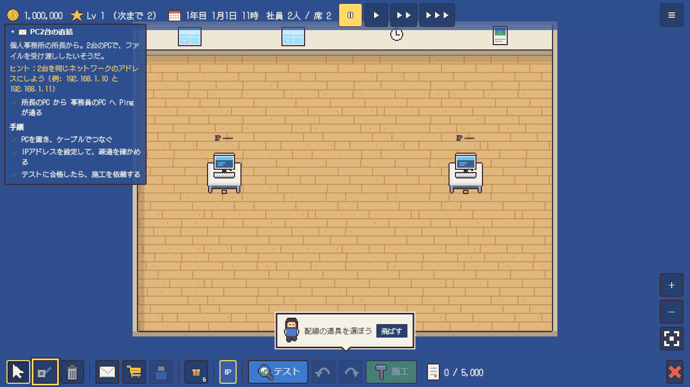
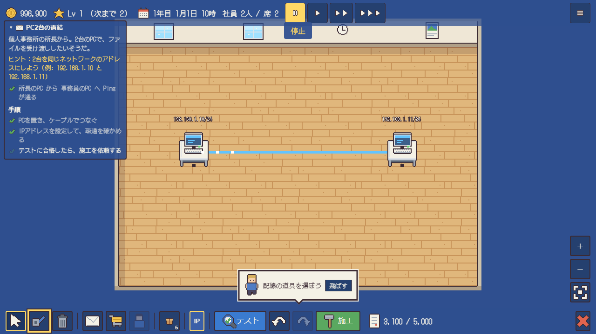
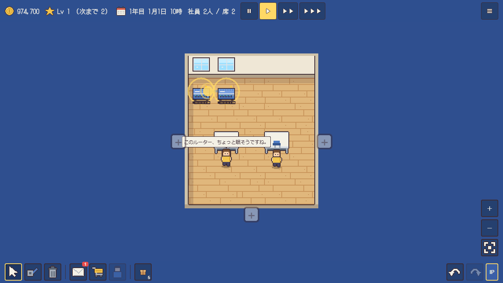
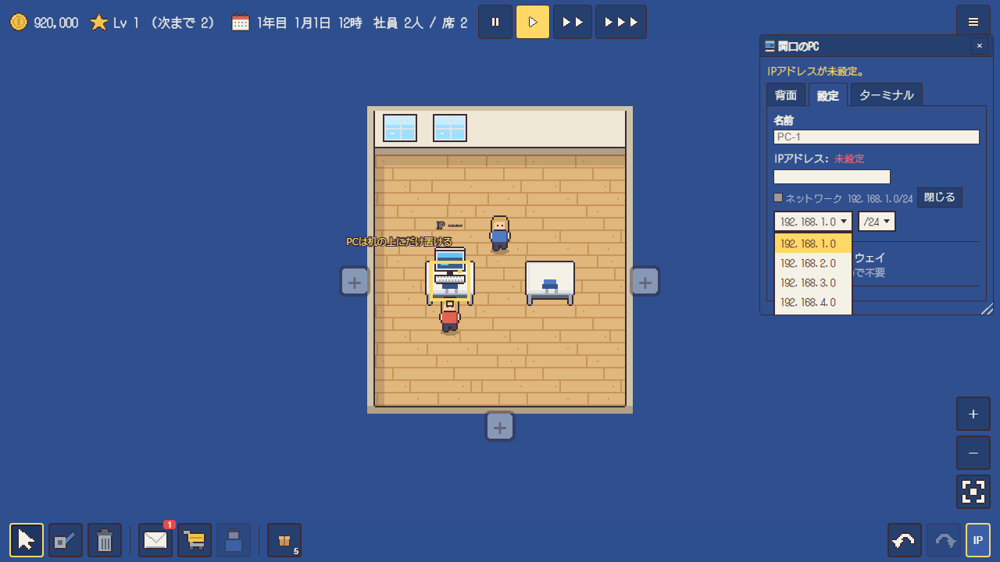
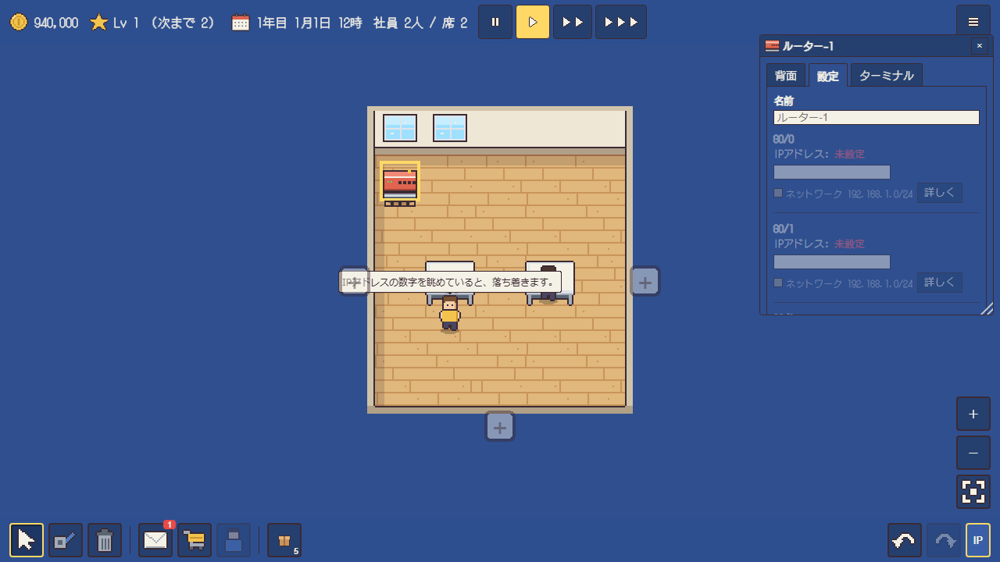

# 遊び方と操作

## 案件の流れ
1. `M` で案件の一覧を開き、案件を受注する。
2. 案件の設計をする。機器を置き、ケーブルでつなぎ、IP アドレスなどを設定する。
3. `T` で疎通テストをする。テストに合格しないと施工を依頼できない。
4. `B` で施工を依頼する。施工後は元に戻せない。
5. 納品の結果を見る。星の数（★1〜★3）で報酬の倍率が決まる。★3 は、コストを抑え、やり直しなしで完成させたときに取れる。

## ツール
| キー | ツール | 備考 |
| --- | --- | --- |
| `1` | 選択 | 機器を押すと、機器の画面を開く。ドラッグで機器やケーブルを移せる |
| `2` | 配線 | 機器を押し、ポートを選び、相手の機器とポートを選ぶ。ドラッグでも配線できる |
| `3` | 撤去 | 機器・ケーブル・家具を押すと撤去する |

右クリックは撤去です。`Delete` は選んでいる機器・ケーブルを撤去します。

## そのほかのキー
| キー | 備考 |
| --- | --- |
| `Esc` | 配線の途中なら取り消す。ポップアップや画面を閉じる。選択の道具に戻る |
| `Enter` | ポップアップの主のボタン（受注・OK など）を押す |
| `Tab` / `Shift+Tab` | 入力欄・ボタンを移動する |
| `Ctrl+Z` / `Ctrl+Y` | 元に戻す・やり直す |
| `Space` | 一時停止・再開 |
| `[` / `]` | 時間を遅く・速くする |
| `T` | 疎通テスト |
| `B` | 施工の依頼 |
| `I` | IP アドレスの表示を切り替える |
| `M` | 案件の一覧 |
| `S` | ショップ |
| `E` | インベントリ |
| `H` | 社員の一覧 |
| `+` / `-` / `0` | マップの拡大・縮小・全体表示 |
| 矢印キー | マップを動かす |
| `/` | 検索の欄に移る |
| `?` | キー操作の一覧を開く |

マウスだけでも、キーだけでも遊べます。

## 機器の画面
選択の道具で機器を押すと開きます。PC の設定では、ネットワーク欄にネットワークアドレスを入力し、IP アドレスを入れます。ネットワーク欄は候補にない値も入力できます。

ルーターの設定では、各ポートに IP アドレスを入れます。

機器の画面には、背面・設定・サービス・ターミナルのタブがあります。背面では、ポートの接続状態と、つながっているケーブルを確認できます。ポートを押すと、ケーブルを外したり挿し替えたりできます。設定では、IP アドレス・ゲートウェイ・経路のほか、VLAN・OSPF・BGP・VRRP・DHCP・無線などを設定します。サービスでは、サーバーのサービスを起動・停止します。ターミナルでは、Cisco IOS に似た命令で同じ設定を入力し、`show` の命令で状態を確かめられます。

案件で設定が決められている機器は、設定を変更できません。

### サブネットの範囲

プレフィックス長は `/0`〜`/32` を設定できます。`/31` は、2つのアドレスをどちらも機器に使える1対1の回線用です。`/32` は機器1台だけのネットワークです。

## 修理の依頼

すでに引かれたネットワークの不具合を直す依頼です。依頼文には症状だけが書かれています。設定や配線を調べて原因を探し、テストに合格させます。

## サンドボックスと教材

タイトルの「サンドボックス」では、お金や依頼の制約なしに自由にネットワークを組めます。サンドボックスでは教材も開けます。教材は VLAN・OSPF・BGP・VRRP・DHCP・NAT・無線などの論点ごとにあり、用意された構成から始めて、手順に沿って設定を学べます。

## パケットの中身

テストか `ping` を実行したあと、「パケットの中身を見る」で通信の区間ごとの中身を確かめられます。区間ごとに、送信元と宛先の MAC アドレスと IP アドレス、VLAN、TTL が出ます。届かなかった通信は、止まった機器と理由が出ます。

## 社員に任せる

同じ依頼を★2以上で3回納品すると、4回目から社員に任せられます。「型紙で任せる」は、前に納品した設計をそのまま使います。任せた依頼の★は2が上限で、経験値は半分になります。

## サーバーの貸し出し

自社のオフィスでサーバーを外部に公開すると、毎月の収入になります。収入は、外から届くサーバーの台数と、会社のレベルで増える顧客の数で決まります。外から社内の PC にも届く状態では収入がなく、月末に評判が1下がります。状態は「自社の情報」で確かめられます。

## 資金

「資金を見る」で、残高、今月の内訳、月末の見通し、直近12か月の収支を確かめられます。

## オフィス

「設備」から、オフィスを右・左・下に拡張したり、別室を増設したりできます。床はカーペットなどに張り替えられます。

## 会社の保存

会社は複数保存でき、タイトルの「会社を選ぶ」で切り替えます。会社ごとに、社名の変更、複製、削除、ファイルへの書き出しができます。書き出したファイルは「ファイルから読み込む」で別の端末に移せます。

## 設定

メニューの「設定」で、次の項目を変えられます。

| 項目 | 内容 |
| --- | --- |
| UI の大きさ | 画面の文字とボタンの大きさを変えます |
| 時間を進める初期の速さ | 会社を開いたときの速さを決めます |
| 自動保存 | ゲーム内の毎日か毎週に保存します |
| IP アドレスの自動割り当て | 機器を置いたり配線したりしたときに、アドレスを入れます |
| 設計に入ったら時間を止める | 依頼の設計の間、時間を止めます |
| 一時停止中の施工 | 止めたまま施工を依頼したときの扱いを選びます |
| 給与を払えない月は止める | 給与日の直前に資金が足りない場合、時間を止めます |
| 依頼を断るときの確認 | 断る前に確認を出します |
| 名前と IP アドレスの表示・機器の名前 | マップの表示を切り替えます |
| 時刻による画面の色 | 夜などに画面の色を変えます |
| 案内の表示・効果音 | 案内と効果音を切り替えます |

「保存の守り」が守られていない場合は、ブラウザの容量が足りないときに保存が消えることがあります。
