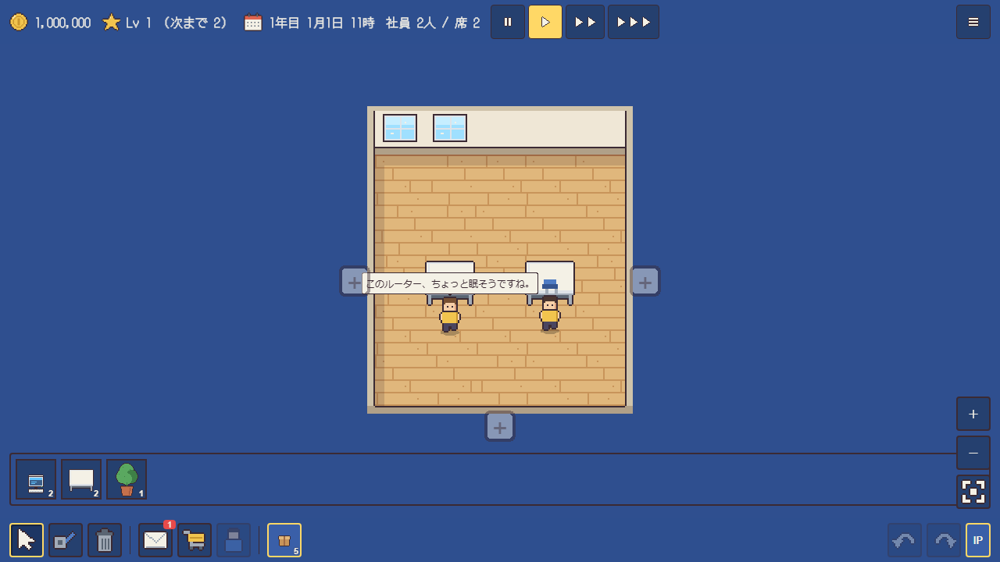

# 機器・家具・ケーブル

画像は、ゲーム内で使っているドット絵です（`src/assets/sprites/`）。
価格は定価です。売却すると定価の80%で売れます（`balance.json` の `sellRate`）。
解禁欄は、ショップに並ぶ会社のレベルです（各品目の `unlockLevel`）。Lv1 の品目は、ゲームの開始時から買えます。
依頼の内容は [依頼一覧](contracts.md) にあります。

## 機器

| 画像 | 名前 | 定価 | ポート | 機能 | 解禁 |
| --- | --- | --- | --- | --- | --- |
|  | 事務用PC | 80,000円 | LAN 1口 | - | Lv1 |
|  | 無線対応のパソコン | 110,000円 | LAN 1口 | 無線 | Lv25 |
|  | ノートPC | 120,000円 | LAN 1口 | 持ち運び | Lv8 |
|  | サーバー | 300,000円 | LAN 1口 | サービス（HTTP 80番を標準で提供） | Lv6 |
|  | GPUサーバー | 1,200,000円 | LAN 1口 | サービス、GPU | Lv32 |
|  | プリンター | 30,000円 | LAN 1口 | - | Lv3 |
|  | 4ポートスイッチ | 6,000円 | LAN 4口 | - | Lv1 |
|  | L2スイッチ（8ポート） | 12,000円 | LAN 8口 | - | Lv2 |
|  | L2スイッチ（16ポート） | 24,000円 | LAN 16口 | - | Lv10 |
|  | L2スイッチ（24ポート） | 36,000円 | LAN 24口 | - | Lv23 |
|  | アクセスポイント | 33,000円 | LAN 1口 | 無線 | Lv25 |
|  | L3スイッチ | 170,000円 | LAN 8口・SFP 2口 | ルーティング、L3（VLAN ごとの SVI で中継する） | Lv20 |
|  | ルーター | 60,000円 | LAN 4口 | ルーティング | Lv4 |
|  | SFP対応ルーター | 65,000円 | LAN 4口・SFP 1口 | ルーティング | Lv16 |
|  | スイッチ付きルーター | 80,000円 | WAN 1口、LAN 4口 | ルーティング、スイッチ | Lv9 |
|  | 家庭用ルーター | 80,000円 | WAN 1口、LAN 4口 | ルーティング、スイッチ、ファイアウォール | Lv20 |
|  | 無線つき家庭用ルーター | 110,000円 | WAN 1口、LAN 4口 | ルーティング、スイッチ、ファイアウォール、無線 | Lv30 |
|  | ファイアウォール | 120,000円 | 2口（内側・外側） | ルーティング、ファイアウォール | Lv27 |
|  | DMZ付きファイアウォール | 125,000円 | 3口（外部・社内・公開用サーバー） | ルーティング、ファイアウォール | Lv36 |

L2スイッチの16口と24口は、8口と同じ絵を使っています。

### 機器の特徴

事務用PCとノートPCは、社員の席に置く機器です。IPアドレスを設定すると、通信の端末になります。サーバーとGPUサーバーは、HTTP などのサービスを待ち受けます。サーバーの画面でサービスを起動・停止し、ポート番号を設定できます。

L2スイッチは、同じネットワーク内の機器をまとめてつなぎます。ルーティングはしません。4ポートスイッチは小型の安いスイッチで、少ない台数をつなぐときや、長い配線の中継に使います。ルーターは、異なるネットワークの間で通信を中継します。各ポートに IP アドレスを設定し、経路（どの宛先をどこへ送るか）を登録します。

スイッチ付きルーターは、WAN の 1口と、スイッチの役割をする LAN の 4口を持ちます。家庭用ルーターは、スイッチ付きルーターと同じ口の構成で、外から始まる通信を既定で止めます。無線つき家庭用ルーターは、家庭用ルーターにアクセスポイントの機能を加えたものです。L3スイッチは、スイッチの中でネットワークを分けたまま、ルーターの役割もします。ルーターを使わずに部署をまたぐ通信ができます。

アクセスポイントは、有線の LAN につなぎ、電波の届く範囲にある無線対応の機器を同じネットワークに結びます。電波は壁で弱まります。無線対応のパソコンは、ケーブルの代わりに電波でアクセスポイントにつながります。

ファイアウォールは、通過する通信を規則で止めたり、通したりします。外部と内部の間に置きます。DMZ付きファイアウォールは、公開用のサーバーを、社内のネットワークから分けて守ります。

## 家具

家具はポートや配線を使いません。オフィスの中に置いて、社員の施工力などを変えます。

| 画像 | 名前 | 定価 | 備考 | 解禁 |
| --- | --- | --- | --- | --- |
|  | 机と椅子 | 30,000円 | 社員が座る席になる。座った社員は、施工力と経験値の補正を受けられる | Lv1 |
|  | 机 | 24,000円 | 椅子のない机。机と椅子と同じく席として数える | Lv1 |
|  | 観葉植物 | 8,000円 | 近く（2マス以内）の席の社員の施工力を、+10% する | Lv1 |
|  | 本棚 | 20,000円 | 近く（2マス以内）の席の社員の経験値を、+10% する | Lv5 |
|  | 書類キャビネット | 15,000円 | 効果なし（置くだけ） | Lv5 |
|  | コーヒーメーカー | 12,000円 | 座っている社員全員の施工力を、+5% する | Lv4 |
|  | ウォーターサーバー | 10,000円 | 座っている社員全員の施工力を、+5% する | Lv7 |
|  | ゴミ箱 | 2,000円 | 効果なし（置くだけ） | Lv1 |
|  | ソファ | 25,000円 | 席がない社員の施工力の係数を、0.5 から 0.7 に上げる | Lv9 |
|  | 段ボール | 2,000円 | 効果なし（置くだけ） | Lv1 |

家具の効果（施工力・経験値）は、座っている社員だけに効きます。席のない社員は、ソファの係数だけが効きます。近くの範囲は、家具と席のマスの距離が 2マス以内のときです。

## ケーブル

| 画像 | 名前 | 最大の長さ | 価格 | 速度 |
| --- | --- | --- | --- | --- |
|  | LANケーブル（Cat5e） | 20マス | 1,000円/本 ＋ 300円/マス | 1000 Mbps |
|  | 光ファイバーケーブル | 400マス | 5,000円/本 ＋ 1,500円/マス | 1000 Mbps |

「本」は、1本の配線（機器のポートとポートをつなぐ 1本）です。「マス」は、ケーブルが通るマップ上のマス数です。光ファイバーは長い距離を結べます。解禁は Lv18 です。

## 機能

機器の機能は、機器の画面や施工の判定で使われます。定価の計算にも使われます（`balance.json` の `pricing.features`）。

| 機能 | 備考 | 定価への加算 |
| --- | --- | --- |
| `routing` | 経路を持ち、異なるネットワークを中継する | 40,000円 |
| `switch` | スイッチとして同じネットワークの機器をつなぐ | 15,000円 |
| `layer3` | VLAN ごとのネットワーク（SVI）で中継する（L3） | 30,000円 |
| `firewall` | 通過する通信を規則で止める | 70,000円 |
| `portable` | 持ち運びできる | 40,000円 |
| `service` | サービスを待ち受ける | 100,000円 |
| `gpu` | GPUを積む | 900,000円 |
| `wireless` | 電波で機器をつなぐ | 30,000円 |

## インベントリの初期の持ち物

ゲームを始めたときのインベントリには、事務用PC 2台と観葉植物 1個が入っています。

資金は、ゲームの開始時に 1,000,000円 です。
