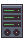
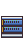
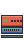
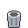

# 機器・家具・ケーブル

画像は、ゲーム内で使っているドット絵です（`src/assets/sprites/`）。
価格は定価です。売却すると定価の80%で売れます（`balance.json` の `sellRate`）。
解禁欄は、ショップに並ぶ条件です。「最初から」は、ゲームの開始時から買えるものです。
依頼の内容は [依頼一覧](contracts.md) にあります。

## 機器

| 画像 | 名前 | ID | 定価 | ポート | 機能 | 解禁 |
| --- | --- | --- | --- | --- | --- | --- |
|  | 事務用PC | `pc_basic` | 80,000円 | LAN 1口 | - | 最初から |
|  | ノートPC | `laptop` | 120,000円 | LAN 1口 | 持ち運び | 「部署間接続」の達成後 |
|  | サーバー | `server_basic` | 300,000円 | LAN 1口 | サービス（HTTP 80番を標準で提供） | 「部署間接続」の達成後 |
|  | GPUサーバー | `gpu_server` | 1,200,000円 | LAN 1口 | サービス、GPU | 「2拠点接続」の達成後 |
|  | L2スイッチ（8ポート） | `l2_switch_8p` | 12,000円 | LAN 8口 | - | 「小規模事務所LAN」の達成後 |
|  | L2スイッチ（16ポート） | `l2_switch_16p` | 24,000円 | LAN 16口 | - | 「社内Webサーバーの接続」の達成後 |
|  | L2スイッチ（24ポート） | `l2_switch_24p` | 36,000円 | LAN 24口 | - | 「2拠点接続」の達成後 |
|  | L3スイッチ | `l3_switch` | 150,000円 | LAN 8口 | ルーティング、L3（ポートごとにネットワークを持つ） | 「2拠点接続」の達成後 |
|  | ルーター | `router_basic` | 60,000円 | LAN 4口 | ルーティング | 「小規模事務所LAN」の達成後 |
|  | スイッチ付きルーター | `router_switch` | 80,000円 | WAN 1口、LAN 4口 | ルーティング、スイッチ | 「部署間接続」の達成後 |
|  | ファイアウォール | `firewall` | 120,000円 | 2口（内側・外側） | ルーティング、ファイアウォール | 「2拠点接続」の達成後 |
|  | DMZ付きファイアウォール | `firewall_dmz` | 125,000円 | 3口（外部・社内・公開用サーバー） | ルーティング、ファイアウォール | 「事務所の外部接続」の達成後 |

L2スイッチの16口と24口は、8口と同じ絵を使っています。DMZ付きファイアウォールも、ファイアウォールと同じ絵です。

### 機器の特徴

- **事務用PC・ノートPC**: 社員の席に置く機器です。IPアドレスを設定して通信の端末になります。
- **サーバー・GPUサーバー**: サービス（HTTP など）を待ち受けます。サーバーの画面でサービスを起動・停止し、ポート番号を設定できます。
- **L2スイッチ**: 同じネットワーク内の機器をまとめてつなぎます。ルーティングはしません。
- **ルーター**: 異なるネットワークの間で通信を中継します。各ポートに IP アドレスを設定し、経路（どの宛先をどこへ送るか）を登録します。
- **スイッチ付きルーター**: WAN の 1口と、スイッチの役割をする LAN の 4口を持ちます。
- **L3スイッチ**: スイッチの中でネットワークを分けたまま、ルーターの役割もします。ルーターを使わずに部署をまたぐ通信ができます。
- **ファイアウォール**: 通過する通信を規則で止めたり、通したりします。外部と内部の間に置きます。
- **DMZ付きファイアウォール**: 公開用のサーバーを、社内のネットワークから分けて守ります。

## 家具

家具はポートや配線を使いません。オフィスの中に置いて、社員の施工力などを変えます。

| 画像 | 名前 | ID | 定価 | 効果 |
| --- | --- | --- | --- | --- |
|  | オフィスデスク | `desk` | 30,000円 | 社員が座る席になる。座った社員は、施工力と経験値の補正を受けられる |
|  | 観葉植物 | `plant` | 8,000円 | 近く（2マス以内）の席の社員の施工力を、+10% する |
|  | 本棚 | `bookshelf` | 20,000円 | 近く（2マス以内）の席の社員の経験値を、+10% する |
|  | 書類キャビネット | `cabinet` | 15,000円 | 効果なし（置くだけ） |
|  | コーヒーメーカー | `coffee` | 12,000円 | 座っている社員全員の施工力を、+5% する |
|  | ウォーターサーバー | `water` | 10,000円 | 座っている社員全員の施工力を、+5% する |
|  | ゴミ箱 | `trash` | 2,000円 | 効果なし（置くだけ） |
|  | ソファ | `sofa` | 25,000円 | 席がない社員の施工力の係数を、0.5 から 0.7 に上げる |
|  | 段ボール | `boxes` | 2,000円 | 効果なし（置くだけ） |

- 家具の効果（施工力・経験値）は、座っている社員だけに効きます。席のない社員は、ソファの係数だけが効きます。
- 近くの範囲は、家具と席のマスの距離が 2マス以内のときです。

## ケーブル

| 画像 | 名前 | ID | 最大の長さ | 価格 | 速度 |
| --- | --- | --- | --- | --- | --- |
|  | LANケーブル（Cat5e） | `utp_cat5e` | 30マス | 1,000円/本 ＋ 300円/マス | 1000 Mbps |
|  | 光ファイバーケーブル | `fiber_sm` | 200マス | 5,000円/本 ＋ 1,500円/マス | 1000 Mbps |

- 「本」は、1本の配線（機器のポートとポートをつなぐ 1本）です。「マス」は、ケーブルが通るマップ上のマス数です。
- 光ファイバーは長い距離を結べます。解禁は「社内Webサーバーの接続」の達成後です。

## 機能（features）

機器の機能は、機器の画面や施工の判定で使われます。定価の計算にも使われます（`balance.json` の `pricing.features`）。

| 機能 | 意味 | 定価への加算 |
| --- | --- | --- |
| `routing` | 経路を持ち、異なるネットワークを中継する | 40,000円 |
| `switch` | スイッチとして同じネットワークの機器をつなぐ | 15,000円 |
| `layer3` | ポートごとにネットワークを持つ（L3） | 30,000円 |
| `firewall` | 通過する通信を規則で止める | 70,000円 |
| `portable` | 持ち運びできる | 40,000円 |
| `service` | サービスを待ち受ける | 100,000円 |
| `gpu` | GPUを積む | 900,000円 |

## 倉庫の初期の持ち物

ゲームを始めたときの倉庫には、次のものが入っています。

- 事務用PC 2台（`pc_basic`）
- 観葉植物 1個（`plant`）

資金は、ゲームの開始時に 1,000,000円 です。
